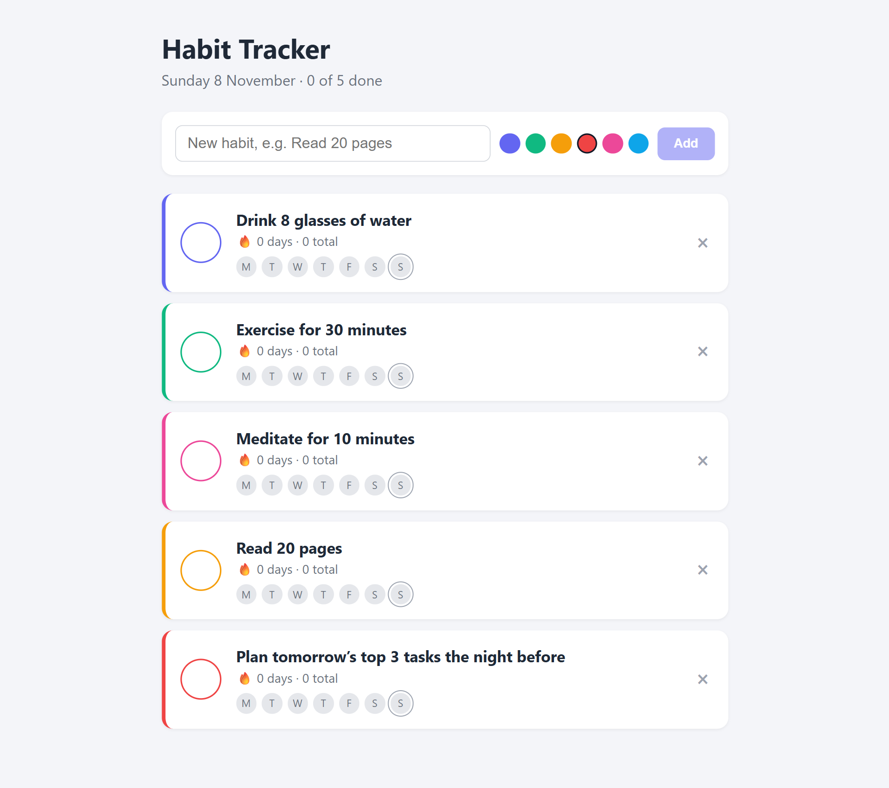

<h1 align="center">✅ Habit Tracker</h1>

<p align="center">
  A simple, full-stack habit tracker to build streaks one day at a time.
</p>

<p align="center">
  
  
  
  
  
  
  
  
</p>

---

## 📸 Screenshots

<!-- Save your screenshots to docs/screenshots/ with the filenames below. -->

<p align="center">
  
</p>

---

## ✨ Features

- ➕ **Create habits** with a name (up to 80 characters) and a color
- ✅ **Check off habits** for today, and uncheck them if you made a mistake
- 🔥 **Streak counter** that stays alive until the end of the day
- 📅 **7-day history strip** showing completions at a glance
- 📊 **Daily progress** summary in the header
- 🗑️ **Delete habits** you no longer need
- 🌍 **Timezone-friendly** dates, computed from the user's local calendar

---

## 🧰 Tech Stack

| Layer     | Technology                                        |
|-----------|---------------------------------------------------|
| Database  | MongoDB with Mongoose ODM                         |
| Backend   | Node.js, Express 4, CORS, dotenv                  |
| Frontend  | React 18, Vite, plain CSS                         |
| API style | REST (JSON)                                       |

---

## 📁 Project Structure

```
habit-tracker/
├── README.md
├── docs/
│   └── screenshots/          Images used in this README
├── server/                   Express + Mongoose API (port 5000)
│   ├── index.js              App setup, Mongo connection, error handling
│   ├── models/
│   │   └── Habit.js          Habit schema
│   ├── routes/
│   │   └── habits.js         REST endpoints
│   ├── .env.example
│   └── package.json
└── client/                   Vite + React app (port 5173)
    ├── index.html
    ├── vite.config.js        Proxies /api to the server
    ├── package.json
    └── src/
        ├── main.jsx
        ├── App.jsx           Main page and state
        ├── api.js            Fetch wrapper for the API
        ├── utils.js          Date and streak helpers
        ├── styles.css
        └── components/
            ├── HabitCard.jsx
            └── AddHabitForm.jsx
```

---

## 🚀 Getting Started

### Prerequisites

- [Node.js](https://nodejs.org/) 18 or newer
- [MongoDB](https://www.mongodb.com/try/download/community) running locally, **or** a free [MongoDB Atlas](https://www.mongodb.com/atlas) cluster

### 1. Clone or unzip the project

```bash
cd habit-tracker-mern
```

### 2. Start the API server

```bash
cd server
cp .env.example .env      # then edit MONGO_URI if you use Atlas
npm install
npm run dev               # runs with auto-reload; use `npm start` for production
```

You should see:

```
MongoDB connected
API listening on http://localhost:5000
```

### 3. Start the React client

Open a second terminal:

```bash
cd client
npm install
npm run dev
```

Open **http://localhost:5173** in your browser.

---

## ⚙️ Environment Variables

Configure these in `server/.env`:

| Variable      | Default                                       | Description                          |
|---------------|-----------------------------------------------|--------------------------------------|
| `PORT`        | `5000`                                        | Port the API listens on              |
| `MONGO_URI`   | `mongodb://127.0.0.1:27017/habit-tracker`     | MongoDB connection string            |
| `CLIENT_URL`  | `http://localhost:5173`                       | Allowed origin for CORS              |

For MongoDB Atlas, set `MONGO_URI` to your connection string, for example:

```
MONGO_URI=mongodb+srv://<user>:<password>@<cluster>.mongodb.net/habit-tracker
```

---

## 🔌 API Reference

Base URL: `http://localhost:5000/api`

| Method   | Endpoint                 | Body                  | Description                                  |
|----------|--------------------------|-----------------------|----------------------------------------------|
| `GET`    | `/habits`                | —                     | List all habits                              |
| `POST`   | `/habits`                | `{ "name", "color" }` | Create a habit                               |
| `POST`   | `/habits/:id/toggle`     | `{ "date": "YYYY-MM-DD" }` | Add or remove a completion for that date |
| `DELETE` | `/habits/:id`            | —                     | Delete a habit                               |
| `GET`    | `/health`                | —                     | Health check                                 |

### Example

```bash
# Create a habit
curl -X POST http://localhost:5000/api/habits \
  -H "Content-Type: application/json" \
  -d '{"name":"Read 20 pages","color":"#10b981"}'

# Mark it done for today
curl -X POST http://localhost:5000/api/habits/<id>/toggle \
  -H "Content-Type: application/json" \
  -d '{"date":"2026-11-08"}'
```

---

## 🧠 How Streaks Work

- Completions are stored as `YYYY-MM-DD` strings sent by the browser, so they match the user's local day.
- A streak counts consecutive completed days ending **today**.
- If today isn't checked off yet, the streak counts back from **yesterday**, so it doesn't reset until the day is actually missed.

---

## 🛠️ Troubleshooting

| Problem | Fix |
|---------|-----|
| `MongoDB connection failed` | Make sure `mongod` is running, or check `MONGO_URI` in `server/.env`. |
| Client shows a network error | Confirm the API is running on port 5000 and that `npm run dev` is running in `client/`. |
| CORS error in the browser | Make sure `CLIENT_URL` in `server/.env` matches the URL you're opening (default `http://localhost:5173`). |
| Port already in use | Change `PORT` in `server/.env` and the proxy target in `client/vite.config.js`. |

---

## 🗺️ Roadmap

- User accounts and authentication
- Edit habit names and colors
- Monthly calendar view
- Weekly and monthly stats
- Reminders and notifications
- Dark mode

---

## 🤝 Contributing

Contributions are welcome. Fork the repo, create a branch, make your changes, and open a pull request.

---

## 📄 License

Released under the [MIT License](LICENSE).

## 👨‍💻 Author

**Ajinkya Dhatrak**

GitHub: [@ajinkya029](https://github.com/ajinkya029)

---

⭐ If you find this project useful, consider giving it a star!
